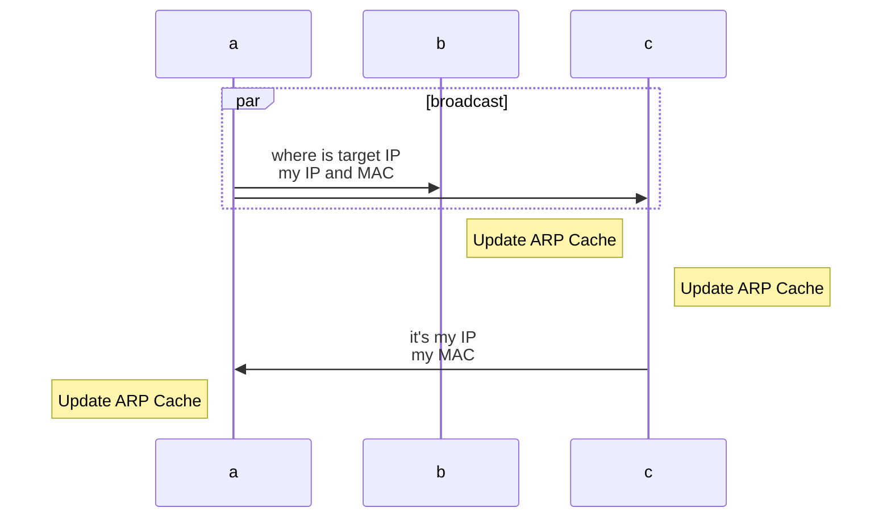
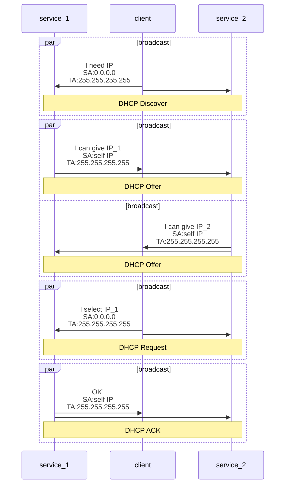

# 1 计算机网络体系结构
数据传输方式：  
  - 电路交换：占用连接后，直接传输
  - 报文交换：将数据封装成报文，逐级存储转发
  - 分组交换：将报文分成多个分组，各自逐级存储转发

*性能坐标*：
* 带宽：数字信道所能支持的最高数据传输速率，单位`bps`
* 吞吐量：单位时间内通过某网络的实际数据量
* 时延：数据从网络的一端到另一端所需的总时间，包括
  - 发送时延：节点将分组的所有比特推入链路所需的时间，节点包括收发端和路由器
  - 传播时延：信道的长度`m`/传播速率`mps`
  - 处理时延 
  - 排队时延：在路由器的输入队列和输出队列等待的时间
* 时延带宽积：
  - 指发送端发送的第一个比特即将到达接收端时，发送端以发送的比特总数
  - 即已发出但尚未到达接收端的最大比特数
  > 传播时延 * 信道带宽
* 往返时延（RTT）
* 信道利用率：信道有数据通过的时间占总时间的百分比

## 1.2 层次结构
**关键词**：
* *协议*：控制对等实体之间通信的规则集合，三要素：语法、语义、同步（时序）
* *服务*：下层为相邻的上层提供的功能调用
* *协议数据单元*（`PDU`）：对等层之间传送的数据单位  
如比特流（物理层间），帧（数据链路层），IP分组（网络层），TCP报文段/UDP数据报（传输层）  
* *服务数据单元*（`SDU`）：相邻层之间交换的数据单位  
* *协议控制单元*（`PCI`）：用于控制协议操作的信息  

**OSI参考模型**：
* 应用层：用户与网络的接口
* 表现层：解决异构系统间信息表示不一致的问题，数据压缩、加密解密
* 会话层：会话，同步，断点续传
* 传输层：进程到进程（`端口号`），流量控制，分组排序，复用与分用
* 网络层：主机到主机（`IP`），流量控制
* 数据链路层：节点到节点（`MAC`），流量控制
* 物理层：
  - 规定接口的机械特性和电气特性
  - 规定通信链路上的编码意义和电气特征

**TCP/IP模型**：
* 应用层
* 传输层
* 网际层
* 网络接口层

# 2 物理层
## 2.1 基本概念
* 码元传输速率（波特率，调制速率）：每秒传输的码元数，`Baud`
* 信息传输速率（比特率）：每秒传输的比特数，`bps`
* 奈氏准则：
> 极限数据传输速率 $=2W\log{V} $`bps`  
W：信道的频率带宽`Hz`，2W：码元传输速率，V：每个码元的离散电平数量
* 香农定理：
> 极限数据传输速率 $=W\log{(1+S/N)} $`bps`  
W：信道的频率带宽，S：信号的平均功率，N：噪声功率  
S/N：信噪比，其中采用分贝计数时需转换：$10n$ `dB` $ = 10^n$ `信噪比`
  
### 编码与调制
* 编码：数据转换为数字信号的过程  
* 调整：数据转换为模拟信号的过程  
1. 数字数据编码为数字信号
* 归零编码`RZ`：中间跳变用于时钟同步
* 非归零编码`NRZ`：需额外时钟线来同步
* 反向非归零编码`NRZI`：起始跳变表示数据
* 曼切斯特编码：中间跳变同时承担时钟同步与数据表示功能  
* 差分曼切斯特编码：中间跳变用于时钟同步，起始跳变用于表示数据
2. 模拟数据编码为数字信号
3. 数字数据调制为模拟信号

## 2.2 传输介质（导向传输介质、非导向传输介质）
1. 双绞线
* 价格低廉，不适合长距离传输
* 绞合可以减少干扰
2. 同轴电缆
* 良好的抗干扰能力，适合较高速率的数据传输
* 半双工通信
3. 光纤
* 通信容量极大，传输损耗小，抗雷电和电磁干扰性能强，无串音干扰，保密性好，体积小，重量轻
4. 无线传输介质
* 卫星通信：通信容量大，覆盖范围广、传输距离远；保密性差，时延大
* 红外线：极易受障碍物阻拦

### 接口特性
* 机械特性：接线器的形状和尺寸、引脚数目和排列、固定和锁定装置
* 电气特性：电压范围、传输速率和距离限制
* 功能特性：特定电平的意义、各线路的具体功能
* 过程特性（规程特性）：功能事件发生顺序和时序关系

## 2.3 物理层设备
*中继器*：仅两个端口，用于数据输入输出  
主要功能：整形、放大并转发信号
*集线器*：多端口的中继器，所有端口平均共享集线器的带宽  
主要功能：将一个端口来的数据广播到其余所有端口

# 3 数据链路层
## 3.1 链路层的功能
*解决的基本问题*：
* 封装成帧
* 透明传输 
* 差错检测：
  - 循环冗余校验（bit位发生翻转）
  - 帧编号、确认与重传（帧丢失，计时器超时重传）
*信道*：
* 点对点信道
* 广播信道

## 3.2 组帧（封装成帧）
组帧必须添加首尾两部分，因为接收方必须知道帧在bit流中的准确位置  
**透明传输**：使数据链路层对上层交付的PDU无限制  

实现`帧定界`、`帧同步`和`透明传输`：  
* *字符计数法*：
  - 帧首部设置计数字段，记录总字节数（自身占1B）
  - 缺陷：若在传输中出错，就无法正确识别帧的边界，失去同步性  
* *字节填充法*：
  - 通过特定控制字符实现帧定界，`SOH`起始字符、`EOT`结束字符、`ESC`转义字符  
  - 适用于：面向字节的物理链路的透明传输
* *零比特填充法*：
  - 0111 1110作为帧的起始和结束标志，每遇到5个连续的‘1’，就插入一个‘0’
  - 接收方收到5个连续的‘1’后，若后一位为‘0’则删除改为，若为‘1’则说明是帧的首/尾标志  
  - 易于硬件实现，性能优于字节填充  
  - 适用于：面向比特的物理链路的透明传输
* *违规编码法*：
  - 利用曼切斯特编码中违规的‘高-高’/‘低-低’电平标识首尾
  - 无需任何填充技术即可实现透明传输；仅适用于采用冗余编码的环境

## 3.3 差错控制
*码距*：两个码字比特不相同的数量  
*编码集的码距*：集合中最小的码距  

*差错控制理论*：  
> 码距l = 检错位数d + 纠错位数c + 1，且$d \ge c$
### 检错编码
为有效信息附加冗余位（校验位）  
1. 奇偶检验码
    * 奇检验码：加上检验码后，‘1’的个数为奇数
    * 偶检验码：加上检验码后，‘1’的个数为偶数
2. 循环冗余码`CRC`
    * 有效位左移r位，用长度为r+1的G(x)对长度为M+r位的有效位扩展串进行模2除法，得到的余数替换有效位扩展串的后r位
    * 接收方用G(x)对有效位扩展串进行模2除法，若余数位0，则无差错  

**二进制模2除法**：以异或（XOR）为核心的除法运算，不借位、不进位，所有加减法都等同于异或

### 纠错编码
某一位出错，会导致其所属的多个检验组出错，从而定位错误  
*海明码*：
> $2^k \ge$ 有效位n + 检验位k + 1（无错状态）  
优点：少量冗余校验位，实现单比特错误的定位和纠错

## 3.4 流量控制与可靠传输机制
### 流量控制
*流量控制*：由接收方控制发送方的发送速率  

*控制方法*：
* 停止-等待 流量控制原理  
  - 发送方一次只发一帧，接收方返回确认帧
* 滑动窗口 流量控制原理
  - 发送窗口  
  决定发送方在未收到确认帧时，最多还能发送的帧数
  - 接收窗口  
  控制接收方还能接收多少帧
### 可靠传输机制
*可靠传输*：发送方发出的数据能够被接收方正确且完整地接收  
#### 自动重传请求`ARQ`协议：
* 机制：
  - 确认：接收方每成功接收一个数据帧，就发送一个确认帧  
  - 超时重传：发送方在发送数据帧后启动计时器，若未在指定时间内收到确认帧就重传  
* 类型：
  - $发送窗口：W_t$ ; $ 接收窗口：W_r $
  - 停止-等待协议：一数据帧一确认帧
  - 后退N帧协议`GBN`：超时重传时，不仅要重传对应帧，还需重传其后所有已发送但未被确认的帧
    - 若采用n比特对帧编号，则 ：
      - $W_r = 1$
      - $1 < W_t\le 2^n - W_r：W_r$超过上限无法分辨新旧数据分组
  - 选择重传协议`SR`：仅重传出错或超时的数据帧
    - 若采用n比特对帧编号，则 ：
      - $1 < W_r \le W_t：W_r$超过$W_t$无意义，浪费
      - $W_r + W_t \le 2^n：$接收窗口正确接收并滑动后，若返回的确认帧丢失，发送方超时重传的数据帧可能被接收方为以为是新的数据帧
* 信道利用率：发送方从发送第一个数据帧到接收到其确认帧的时间内，发送方发送所有数据帧的时间的占比
  - 数据发送时延：$T_d$，确认分组发送时延：$T_a$（通常忽略不计），往返时延：$RTT$
  - 停止-等待协议：$(T_d) / (T_d + RTT + T_a)$
  - 连续ARQ协议： $(N * T_d) / (T_d + RTT + T_a)$

## 3.5 介质访问控制`MAC`
*主要任务*：协调共享同一信道的各节点的传输行为，以避免彼此之间的信号冲突  

*介质访问控制的方式*：  
* 静态划分信道
  - 信道划分介质访问控制：通过复用技术将同一传输介质上的多个设备通信隔离开来  
  复用：发送端将多个发送方的信号组合到一条物理信道上传输
    - 时分复用`TDM`：将信道的传输时间划分为等长的时间片（TDM帧），用户占用TDM帧的固定序号的时隙
      - 要求：
        1. 介质的位速率大于单个信号的位速率
        2. 介质的带宽大于结合信号的带宽
      - 缺点：信道利用率较低
      - 统计时分复用`STDM`（异步时分复用）：动态分配时隙，提高信道利用率
    - 频分复用`FDM`：将信道的总频带划分为多个子频带，用户使用单个子频带
      - 优点：充分利用传输介质的带宽，系统效率较高，且实现相对简单  
    - 波分复用`WDM`：光的频分复用
    - 码分复用`CDM`：
      - 结构：
        1. 将每个比特时间划分为m个短的时间槽（码片），即每m个码片传输1个bit有效信息
        2. 为每个站点分配一个唯一的m位码片序列（传比特1时发送该码片序列，传0时发送该码片的反码）
            - 要求：
              - 不同站点码片序列必须不同
              - 任意不同站点的两个码片序列的规格化内积（对应项之积，取平均值）为0
              - 各码片仅站点自身和基站知道
      - 传输：
        1. 若向A、B站点同时传输数据，根据A、B各自的码片序列对各自的数据转化为向量，并将向量叠加到公共信道上
        2. 接收方接收到公共信道上的复合向量后，用自己的码片向量和复合向量规格化内积即可得到传输的数据
* 动态划分信道
  - 随机访问介质访问控制：依靠协议解决冲突
    - `ALOHA`协议
      - 纯`ALOHA`协议：有数据就直接发送，若在指定时间内未收到确认，则再等待一段随机时间后重传
      - 时隙`ALOHA`协议：将时间划分为等长的时隙，要求只能在时隙的起始时刻发送数据，且每帧的发送时间不大于时隙长度。其他与纯`ALOHA`相同
    - `CSMA`协议：`ALOHA` + 载波监听机制
      - 1-坚持`CSMA`协议：发数据前先监听信道，若空则发，若忙则持续监听
      - 非坚持`CSMA`协议：发数据前先监听信道，若空则发，若忙则等待随机时间后再监听
      - p-坚持`CSMA`协议：发数据前先监听信道，若空则有p的概率发送，若忙则等待下一个时隙继续监听
      - `CSMA/CD`协议（载波监听+冲突检测）：适合有线总线形以太网
      - `CSMA/CA`协议（载波监听+冲突避免）：适合无线局域网
  - 轮询访问介质访问控制：设置监控站，循环访问各节点来分配信道
    - 令牌传递协议：一个令牌在环形网络中的各节点间依次传递，令牌用于控制信道使用
      - IEEE802.5令牌环网络的传递过程：
        1. 环路中仅有令牌帧在循环传递
        2. 有数据发送的节点收到令牌帧后，修改令牌标志位，添加数据，然后发送出去
        3. 节点收到带数据的令牌后，根据目的地址与自己是否相同来判断是否复制数据。最后都需要转发令牌出去
        4. 当源节点收到带数据的令牌后，若源地址与自己相同，则根据帧中信息判断是否需要重传，若不需要重传则还原令牌，然后转发令牌

## 3.6 局域网`LAN`
*IEEE802中数据链路层分为*：
  * 逻辑链路控制层`LLC`
    - 与接入传输介质有关的内容
    - 主要功能：组帧和拆帧、差错检测、透明传输
  * 介质访问控制层`MAC`
    - 与传输介质无关，向网络层提高无确认无连接服务、面向连接服务、带确认无连接服务等

### 以太网与IEEE 802.3
*定义*：符合DIX Euthernet V2标准的局域网，有线局域网技术  

*简化通信的方式*：
  - 采用无连接的工作方式，提供不可靠的尽最大努力交付服务
  - 所有数据使用曼切斯特编码发送
#### 以太网的传输介质与网卡
*以太网名称*：  
  - 10Base-5、10Base-T、10Base-F
  - 10表示传输速率10Mbps
  - Base表示基带以太网
  - “5”表示单端最大传输距离为500m，“T”代表双绞线，“F”代表光纤

*常见传输介质*：粗缆、细缆、双绞线和光纤  
计算机与外界局域网的连接通过主板上的 *网络适配器*（网卡）实现

#### 以太网MAC地址
*MAC地址的特性*：
  - 长为48位
  - 所有局域网适配器的MAC地址均不重复
  - 计算机只要不更换适配器，MAC就保持不变

#### `CSMA/CD`协议
适合总线形网络或半双工网络环境  
- 载波监听：站点在发送前和发送中持续检测信道
- 冲突检测`CD`：检测信道的电压变化，若变化幅度超出门限值，则视为发生冲突，立即停止发送，并等待随机时间后重试

*帧间最小间隔*：
  - 用途：检测到信道空闲，且空闲持续帧间最小间隔后才能发送信息
  - 定义：$9.6\mu s$，即96bit的发生时间
  - 意义：用于确保接收站清空上一帧的缓存

*争用期*（冲突窗口）：
  - 定义：以太网端到端往返传播时延  
  - 意义：争用期结束仍未检测到冲突，则确定发送成功
  - 规定：$10Mbps的 51.2\mu s，100Mbps的 5.12\mu s$

*最短帧长*：
  - 前提：由于信息发送成功后，站点无法再检测是否发生冲突
  - 意义：若发送时延大于等于争用期，其他站点必然因信道忙而无法发送信息导致形成冲突
  - 定义：最短帧长 = 2 * 最大单项传播时延 * 数据传输速率

*强化碰撞*：
  - 用途：检测到冲突后，站点除停止发送数据外，还需发送人为干扰信号
  - 意义：确保所有站点感知到冲突

*退避算法*：
  - 退避随机`r`个争用期后重传，$r \le 2^{\min(重传次数, 10)}-1$
  - 若重传16次仍失败，则放弃该帧并向高层报错

#### 以太网的MAC帧
DIX Ethernet V2（以太网V2）标准：
* 帧前8B前导码：
  - 前7B为前同步码：用于实现比特同步
  - 后1B为帧开始定界符
  - 以太网帧不需要帧结束定界符，因为有固定的“帧间最小间隙”
* 目的地址：6B
* 源地址：6B
* 类型：2B，标记上一层使用的协议
* 数据：46~1500B，上层的协议数据单元
* 检验码`FCS`：4B，检验范围从目的地址到数据字段

#### 高速以太网
- 100Base-T以太网：双绞线，半双工和全双工
- 吉比特以太网：双绞线和光纤，半双工和全双工
- 10吉比特以太网：双绞线和光纤，全双工

### IEEE 802.11 无线局域网
#### 无线局域网的组成
1. 有固定基础设施的无线局域网
   - `MAC`层使用`CSMA/CA`协议
   - 无线局域网的最小构件是基本服务集`BSS`
   - `BSS`中站点通信必须通过接入点`AP`
   - 多个`BSS`通过各自的`AP`连接到同一个分配系统`DS`，形成一个服务集`ESS`
2. 无固定基础设施的移动自组织网络（自组网络）

#### `CSMA/CA`协议
*确认/重传机制*：站点发完一帧后，必须收到接收方的确认帧，才发送下一帧  
*介质访问控制方式*：
  - 分布式协调功能`DCF`：各站点竞争信道的发送权
  - 点协调功能`PCF`：由`AP`将发送权轮流分配给各站点

帧间间隔`IFS`：信道空闲后，仍需等待一段时间
  - 分布式协调IFS（DIFS）：最长，在DCF下发送数据帧和管理帧
  - 点协调IFS（PIFS）：在PCF下
  - 短IFS（SIFS）：最短，隔离同一对话中的连续帧

**算法机制**：  
信道空闲时，先等待DIFS，再开始争用信道，执行退避算法（另：第一个数据帧不需要退避）  
**退避算法**：  
  - 随机一个退避时隙数开始计时，倒计时为0时再发送数据
  - 时隙数 $\le 2^{\min(4+重传次数, 10)}-1$

**虚拟载波监听机制**：  
原站点在帧首部添加**持续期**字段（该帧发送以及确认回复的总时长），非目的站点接收到后，修改自身的网络分配向量`NAV`，在NAV倒计时结束前不发送信息，以此避免冲突  

**信道预约机制**：  
利用虚拟载波监听机制：若A站要向AP发送数据帧DATA：
  - 首先A站等待信道空闲再等待DIFS时间后发送“请求发送”控制帧`RTS`，使其他站点不要在后续[SIFS+CTS+SIFS+DATA+SIFS+ACK]的时间内发送信息
  - 当AP收到RTS帧且信道空闲时，等待SIFS时间后发送“允许发送”控制帧`CTS`，使A站发送DATA帧，其他站点不要在后续[SIFS+DATA+SIFS+ACK]的时间内发送消息
  - 当A站收到CTS后，等待SIFS时间后发送DATA帧，持续起字段写入时间[DATA+SIFS+ACK]

#### 802.11局域网的MAC帧
共三类帧：数据帧、控制帧、管理帧  
802.11帧由三部分组成：
  * MAC首部
    - 数据帧中：
      - 帧控制字段：
        - 类型：2b，表示帧为数据帧还是控制帧还是管理帧
        - 子类型：4b，表示类型的子类型
        - 去往AP、来自AP：各1b
        - 4个地址：地址1表示接收地址，地址2表示发送地址，地址3表示源地址或目的地址，地址4用于自组网络
        - 其他
    - RTS帧中：仅帧控制、持续期、接收地址、发送地址
    - CTS、ACK帧中：仅帧控制、持续期、接收地址
  * 帧主体：即数据部分
  * 帧检验序列`FCS`

### `VLAN`基本概念与基本原理
虚拟局域网`VLAN`：将大型局域网划分为若干个`VLAN`，构成多个独立的广播域  
*划分方式*：
  - 基于端口：将交换机的若干物理接口划为一个VLAN
  - 基于MAC地址
  - 基于IP地址

IEEE 802.1Q帧在标准以太网帧的地址字段和类型字段间插入了4B的VLAN标签，用来标识所属VLAN。  
（为保证最小帧长，数据字段最小长度减为42，最大长度不变）

*干线链路*（汇聚链路）：连接两个交换机的链路  
干线链路上传输802.1Q帧，交换机与站点传输标准以太网帧

## 3.7 广域网`WAN`
局域网与广域网互联通过路由器实现  
传播方式：通过节点交换机存储转发分组  
节点间采用点对点连接  

### 点对点协议`PPP`
用途：用户接入互联网时与ISP之间的通信；两网络设备之间通过直连专线通信  
PPPoE：在以太网中运行的PPP  
*PPP组成*：
  * 链路控制协议`LCP`：用于建立、配置、测试数据链路连接
  * 网络控制协议`NCP`：根据网络层的协议，建立和管理逻辑连接
  * 将IP数据包封装到串行链路的方法

*PPP的特点*：
  - 链路建立阶段使用确认机制，数据传输阶段仅提供无差错接收，故提供的是有连接的不可靠服务
  - 仅支持全双工的点对点链路
  - PPP链路两端允许运行不同网络层协议
  - 面向字节，以字节为最小单位

## 3.8 数据链路层设备
### 交换式以太网
使用**以太网交换机**（二层交换机）连接构成的局域网  
特点：
  - 本质上是多端口的网桥，将网络划分为多个冲突域
  - 纯交换机构成时，采用全双工通信，不需要CSMA/CD协议
  - 端口独立带宽，交换机总吞吐量为各端口带宽和
  - 即插即用，转发表（交换表）通过自学习算法自动更新
  - 采用专用交换结构芯片，交换速率高

*交换方式*：
  - 直连交换方式：
    - 接受到目的MAC后，立即转发，不等整个帧接收完
    - 缺点：不能差错检测
  - 存储转发交换方式
    - 接收完整个帧后，再转发
    - 优点：可靠性高，支持不同速率端口之间的通信
    - 缺点：转发时延较大

*自学习算法*：
  - 学习源MAC地址
  - 查看目的MAC地址
    - 单播帧：通过转发表查询端口进行转发，若未找到则对该帧洪泛广播
    - 广播帧：直接将帧泛洪到除接受端口外的所有端口
    - 组播帧

### 共享式以太网
使用**集线器**连接构成的局域网  
特点：
  - 属于**物理层**
  - 采用半双工通信和CSMA/CD协议
  - 单一冲突域、广播域，范围过大
  - 共分带宽
  - 仅支持广播


# 4 网络层 
## 4.1 网络层的功能
OSI中：使用面向连接的虚电路服务  
TCP/IP中：负责提供无连接的数据报服务
### 异构网络互连
异构网络：网络的拓扑结构、寻址方案、差错处理方法、路由选择机制等不尽相同  
网络互连：用路由器进行网络连接和路由选择

### 路由与转发
路由器的核心功能：
  * 路由选择：根据路由协议维护路由表，计算到达目的网络的最优路径
  * 分组转发：根据转发表将到达的分组从合适端口转发出去

### 两类分组交换服务
#### 虚电路（OSI）
- 通信过程：建立虚电路、数据传输、虚电路释放
- 仅在建立虚电路时使用完整的源和目的地址，后续分组仅使用虚电路号
- 每个中间节点都需维护一个虚电路表

特点：
  - 建立与释放连接开销大
  - 路由选择在连接建立阶段完成
  - 提供可靠、有序的分组交付，并支持端到端的流量控制
  - 对节点或链路的故障敏感
  - 分组开销小

注意：
  - 虚电路连接可以是临时的（SVC），也可以是永久的（PVC）

#### 数据报（TCP/IP）
- 主机对应用层报文分组
- 中间节点对分组暂存，独立选路后转发

特点：
  - 无需建立连接
  - 尽最大努力交付
  - 分组携带完整地址
  - 存在排队时延和丢包发现
  - 故障适应能力强
  - 资源利用率高

### SDN（软件定义网络）
网络层可抽象为两个逻辑平面：控制平面（用于路由选择）、数据平面（用于分组转发）  

`SDN`：用于解耦两个逻辑平面  
  - 路由器仅保留数据平面的功能
  - 由一个逻辑集中式的远程控制器统一路由选择，计算出最优转发路径后，将流表转发给各路由器

SDN的三类接口：
  - 北向接口：向上层应用提供标准化API
  - 南向接口：实现控制器与转发设备之间的双向通信，如`OpenFlow`协议
  - 东西向接口：用于控制器集群内部通信

优势：
  - 集中控制、分布转发
  - 灵活可编程
  - 降低成本

挑战：
  - 集中化的控制器易受攻击，崩溃会影响整个网络
  - 网络规模扩大后，控制器成为网络性能瓶颈

### 拥塞控制
*拥塞*：网络中出现过量分组，超过其处理能力时所引发的性能下降现象  

*拥塞控制的方法*：
  * 开环控制：运行前设定静态策略防止拥塞发生
  * 闭环控制：运行时动态检测并反馈至控制节点进行调整

## 4.2 IPv4
### IPv4分组
首部（20B+，必须是`4B`的整数倍）
<!-- ```
0      4       8             16  19           31b
| 版本 |首部长度|   区分服务   |      总长度     |
|          标识              |标志|   片偏移    |
|    生存时间   |     协议    |     首部校验和   |
|                     源地址                   |
|                    目的地址                   |
|                    可选字段              [填充]
``` -->
|0|4|8|16|19|31|
|-|-|-|- |- |- |
|版本|首部长度|区分服务|总长度|
|标识|||标志|片偏移|
|生存时间||协议|首部校验和|
|源地址|
|目的地址|
|可选字段[填充]

字段含义：
  - **版本**：IP协议的版本，IPv4即为4
  - **首部长度**：以`4B`为单位
  - **总长度**：以`1B`为单位
  - **生存时间**`TTL`：还能经过多少路由器，为0时数据报会被丢弃
  - **协议**：运输层的协议，TCP为6、UDP为17、ICMP为1

IP数据报  

**最大传送单元**`MTU`：链路层数据帧能承载的最大数据量  
以太网的MTU一般为1500B  
数据报需要分片，分片仅在源主机或路由器上进行，重组仅在目的主机上进行

负责重组：
- **标识**：分片所属完整数据报的起始地址
- **标志**`Flag`：MF是否不是最后一个分片；DF是否不能再次分片
- **片偏移**：分片在完整数据报的偏移位置，以`8B`为单位  
（故除最后一个分片，其余分片的数据长度必须是`8B`的整数倍）

### IPv4地址
#### 分类编址
- A类：单播，网络号（8b，0开头）+主机号（24b），有效起始网络号1
- B类：单播，网络号（16b，10开头）+主机号（16b），有效起始网络号128.0
- C类：单播，网络号（24b，110开头）+主机号（8b），有效起始网络号192.0.0
- D类：多播，1110开头，有效起始网络号224.0.0.0
- E类：1111开头，有效起始网络号240.0.0.0

特殊IP地址：
  - 主机号全0：网络本身
  - 主机号全1：直接广播地址（网络号的网络内）
  - 127.x.x.x：本地环回测试，本地进程间通信
  - 0.x.x.x：特殊用途，其中0.0.0.0表示本机
  - 255.255.255.255：受限广播地址（当前网络内）

IP地址的特点：
  - 由网络号和主机号组成
  - IP地址标识网络接口。连接不同网络时每个网络接口有一个IP地址
  - 集线器或交换机不能分割广播域，路由器可以

#### 子网划分
**子网**：在原二级分类编址中加入子网号字段  
**子网掩码**：一串1后跟一串0，1对应IP的网络号和子网号，0对应主机号  
**默认网关**：本子网所连路由器接口的IP地址，用于将数据转发至外部网络  

主机发送数据时，会将目的IP与自身IP和子网掩码比较是否在同一子网中：
  - 若在同一子网，直接交付：通过ARP获得目的MAC地址，直接发送
  - 若不在同一子网，间接交付：发往默认网关，通过ARP获取目的MAC地址，通过路由器转发

划分类型：
  - 定长子网划分`FLSM`：各子网大小相等
  - 变长子网划分`VLSM`：不等

#### 无分类编址`CIDR`
IP地址由网络前缀和主机号组成  
斜线记法：IP地址/前缀长度，如128.8.18.5/20  

**路由聚合**：将多个较小CIDR地址块（相同网络前缀的连续IP地址）合成为较大地址块

### 网络地址转换`NAT`
将私有IP地址映射为公网IP地址，使其可以访问互联网  

私有IP：10.0.0.0/8、172.16.0.0/12、192.168.0.0/16  
互联网中所有路由器不对目的地址为私有地址的数据报转发

### 网络层转发分组的过程
路由转发表内容：（目的网络地址，下一跳地址）
  - 特定主机路由：网络前缀长度32
  - 网络路由：转发表按前缀长度降序排列
  - 默认路由：0.0.0.0/0

分组转发算法：
  1. 对比IP分组的目的地址，遍历转发表
  2. 若转发表中有该目的地址的特定主机路由，则直接转发
  3. 否则，通过路由项的子网掩码同目的地址“与”运算的结果是否等于该项网络地址，进行转发
  4. 遍历完仍未匹配时，有默认路由按默认路由转发，没有则报错

### 地址解析协议`ARP`
分组进入目的网络后，不再使用IP，而是通过MAC定位  
ARP：将IP地址映射为MAC地址  
每台主机和路由器都有一个ARP高速缓存，存放**本局域网内**个主机和路由器接口的IP地址与MAC地址的映射表（ARP表），ARP表表项有生存时间

**ARP表的建立**：
- 主机a若不知道目的IP的MAC地址
- 广播ARP请求帧（数据内容包适本机的IP和MAC以及目的IP）
- 其他主机接收到ARP请求后，将主机a的IP和MAC的映射关系写入自己的ARP表中
- 同时，若发现请求中的目的IP是自己时，将对主机a发送响应帧（数据内容包括自己的IP和MAC）
- 主机a收到响应帧后，更新自己的ARP表


### 动态主机配置协议`DHCP`
**应用层协议**，通过UDP实现  
用途：为主机动态分配IP地址  

**流程**：
  - DHCP客户**广播**“发现报文”，请求IP地址等配置信息
  - 所有DHCP服务端收到“发现报文”后，**广播**“提供报文，表示可提供的IP等
  - DHCP客户挑选IP，并**广播**“请求报文”
  - 该IP的提供者接收到后，**广播**“确认报文”



分配的IP是临时的，有租用期  

### 网际控制报文协议`ICMP`
**网络层协议**  
用途：更有效地转发IP数据报，并提高交付成功率。  
使主机或路由器能够向源点报告网络中的差错或异常情况  

**ICMP报文的分类**：
  - ICMP差错报告报文
    * 类型：
      * 终点不可达
      * 超时
      * 首部字段错误
      * 改变路由
      * 源点抑制
    * 不能发送的情况
      - 报文是差错报告报文
      - 除第一个数据报片外的后续分片
      - 目的地址是多播或广播的报文
      - 有特殊地址的数据报
  - ICMP询问报文
    * 类型
      * 回送请求和回答报文，（PING使用）
      * 时间戳请求和回答报文

## 4.3 IPv6
特点：
  - 地址空间大，扩展地址层次结构
  - 灵活的首部格式
  - 改进的选项
  - 允许协议继续扩充
  - 支持即插即用，无需DHCP
  - 支持资源的预分配
  - 仅源主机可以分片
  - 首部长度固定40B
  - 安全性强

### 基本首部
IPv6数据报由基本首部和有效载荷组成，有效载荷由数个扩展首部和数据部分组成  

**与IPv4对比**：
  - 取消首部长度字段，基本首部长度固定
  - 取消服务类型字段，由优先级和流标号实现
  - 用有效载荷长度字段代替总长度字段
  - 取消标识、标志和片偏移字段，由扩展首部实现
  - 用跳数限制字段代替TTL字段
  - 用下一个首部字段代替协议字段
  - 取消首部检验字段，由运输层提供差错检测
  - 取消选项字段，由扩展首部实现

**基本首部**（40B）：
|0|4|12|16|24|31|
|-|-|-|-|-|-|
|版本|通信量类|流标号|
|有效载荷长度|||下一个首部|跳数限制|
|源地址（128b）|
|目的地址（128b）|

字段含义：
  - 版本：IP协议版本，IPv6为6
  - 通信量类：区分不同IPv6数据报的类型或优先级
  - 流标号：同属一个流（从特定源点到特定终点）的数据报，流标号相同
  - 下一个首部：数据载荷无扩展首部，则标识上层协议类型；有扩展首部，则标识的一个扩展首部的类型

### IPv6地址
地址类型：
  - 单播
  - 多播
  - 任播：任播地址标识一组接口，但数据报仅交付给最近的一个

表示法：冒号十六进制记法，分8组  
缩写：
  - 省略前导零：组内前面连续的0可省略，但至少保留1位
  - 双冒号替换连续全零组：一个地址只能使用一次
  - 示例：4BF5:0000:0000:0000:0BAF:0000:0000:000A  
    即为：4BF5::BAF:0:0:A

### 从IPv4到IPv6过渡
- 双协议栈
  - 主机同时安装IPv4和IPv6两个协议栈，根据应用层的DNS选择使用的协议栈
- 隧道技术
  - IPv6数据报进入IPv4网络时，将其封装为IPv4数据报后传输

## 4.4 路由算法与路由协议
### 路由算法
用于生成路由表表项  

* 静态路由算法：手动配置
* 动态路由算法：根据网络状态动态调整
  * 距离-向量算法`DV`：如`RIP`协议
    - 理论思想：`Bellman-Ford`算法
      - 两点的最短路径费用，即最短的（起点到中转节点的费用 + 中转节点到终点的最短路径费用）
    - 实现：
      - 各节点距离向量初始化，即记录到达各直连邻居节点的费用
        - **距离向量**：到达各节点的费用
      - 各节点向各自邻居节点发送自身距离向量，各节点依此更新
      - 更新后的节点再向各邻居节点发送自身距离向量，未更新不发送，直至节点都不再更新
  * 链路状态算法`LS`：如`OSPF`协议
    - 得到全网节点拓扑结构图：
      - 主动探测所有相邻节点的状态
      - 定期洪泛自身节点状态到全网
    - 根据拓扑结构图，通过`Digkstra`算法找到最短路径
  
路由表项结构：
  - 目的网络：目的的网络号，非准确地址
  - 子网掩码：点分十进制表示
  - 接口：当前路由器的出接口号
  - 下一跳：下一个路由器的接收接口的IP地址

### 路由选择协议
自治系统`AS`：
  - 互联网被划分成多个AS
  - 每个AS内只能使用一种路由选择协议

路由选择协议分类：
  * 内部网关协议`IGP`：AS内部使用的路由协议，如`RIP`和`OSPF`
  * 外部网关协议`EGP`：各AS之间使用的路由协议，如`BGP`

开销：数据通过链路的代价
  - 路由器内传输的开销，为路由器内收发接口的链路代价的最大值

#### 路由信息协议`RIP`
特点：
  - 是应用层协议，使用`UDP`传送数据
  - 基于距离向量算法
  - 仅以跳数作为费用（有效跳数最多为15，**16**表示不可达）
  - 分类：
    - RIPv1：只支持识别分类编址
    - RIPv2：支持分类编址、子网划分和无分类编址

**工作原理**：
  - 各节点按固定时间间隔（默认30s）向相邻节点发送更新报文，交换完整路由表信息
  - 修改接收到的路由表：将“下一跳”字段修改为发送地址的路由器，所有“跳数”字段加一
  - 对修改后的路由表表项，有选择的加入自身路由表
    - 是新网络；原有网络以最新消息为准；原有网络以最短路径为准
  - 若超时时间内（默认180s）未收到相邻路由器的更新报文，则所有下一跳为该路由器的表项设为不可达

优点：
  - 实现简单、开销小、收敛（得到最优路由表）快
  - **好消息传得快**：更短路由会快速传到其他路由器中

缺点：
  - 最大有效距离15，限制了网络规模
  - 交换完整的路由表，开销大
  - **坏消息传得慢**：网络出故障而不可达时的信息传递极慢
    - 对于网络N，路由器R1直连，路由器R2通过R1连接
    - 当N故障，R1设N为16（不可达），R1必须在固定间隔后才能发送更新报文，若间隔期间R2向R1发送更新报文，传达可以到达N，R1会设N为2，（R2以为R1能到N，R1以为R2能到N）
    - 由于RIP会路由表项以最新消息为准，R1和R2的跳数会反复增加，经过较长时间增大到16时，才知道N已经不可达了

#### 开放最短路径优先协议`OSPF`
特点：
  - 是网络层协议，直接使用`IP`数据报传输
  - 基于链路状态算法
  - 通过洪泛法向该AS中所有路由器发送信息
  - 信息内容：该路由器与邻居路由器之间的链路状态
  - 仅在链路状态变化时才洪泛更新，不会出现

优势：
  - 支持对不同路由使用不同代价计算方式
  - 存在多条至同一目的网络且代价相同的路径时，可以实现负载均衡
  - OSPF分组可以确保仅可信路由器之间交换链路状态信息
  - 支持子网划分和无分类编址
  - 链路状态信息携带32位序号，序号越大，状态越新

**Area**:
  - 将一个AS划分为多个区域`Area`，将洪泛的范围限制在一个area内
  - 每个area必须包含一个或多个区域边界路由器，负责为进出area的分组提供路由
  - AS中必须包含一个主area，它必须包含AS内所有区域边界路由器，负责连接各area
  - 分组在不同area间传送时，必须通过主area转发

**分组的类型**：
  - 问候分组`Hello`：发现邻居维持邻接关系
  - 数据库描述分组`DD`：向邻居发送自己的链路状态数据库`LSDB`中所有链路状态项目的摘要信息
  - 链路状态请求分组`LSR`：向邻居请求发送某些链路状态项目的详细信息
  - 链路状态更新分组`LSU`：通过洪泛法发送链路状态通告`LSA`
  - 链路状态确认分组`LSAck`：对`LSU`确认

**工作原理**：
  1. 邻居发现和可达性
     - 相邻路由器每10s发送Hello分组，确立邻居关系
     - 若40s为收到Hello分组，判定路由器为不可达
  2. 链路状态数据库`LSDB`的初步同步
     1. 相邻路由器通过DD分组发送摘要信息
     2. 路由器对比摘要信息，通过LSR向邻居请求自己缺失或过期的LSA详细信息
     3. 邻居通过LSU分组发送请求的LSA
     4. 接收方接收后需返回LSAck分组，确保可靠传输
     5. 最终实现LSDB的完全同步后，通过`Dijkstra`算法计算最短路径，并仅将下一跳记录到路由表项中
  3. 链路状态变更的实时传播
     - 路由器一旦检测到自己链路状态变化，就生成新的LSA，通过LSU分组传播
     - 其他路由器接收后返回LSAck分组，并更新自己LSDB，重新计算路由
  4. LSA的定期更新
     - 每条LSA最大存活时间为60m，生成该LSA的路由器需定期（默认30m）刷新该LSA

#### 边界网关协议`BGP`
特点：
  - 是应用层协议，使用`TCP`传输
  - 基于路径向量算法

名词：
  - AS中路由器可分为*边界路由器* 和*内部路由器*
  - 边界路由器之间、AS内部的BGP路由器之间，均通过端口为179的半永久TCP连接交换BGP路由信息
  - 每对TCP连接交换BGP报文的路由器会为**BGP对等体**，该TCP连接称为**BGP会话**
  - 跨越两个AS的BGP会话称为**EBGP会话**
  - AS内部的BGP会话称为**IBGP会话**，AS内的任意两台路由器之间都要建立IBGP会话

**BGP路由**：
  - 用途：路由器通过BGP会话向对等体通告一BGP路由，使其更新路由表
  - 格式：
    - 目的网络前缀
    - 自治系统路径`AS-PATH`：记录该BGP路由所经过的AS序列  
      BGP路由每经过一个AS，就会将该AS的唯一标识`ASN`，加入到AS-PATH中
    - 下一跳`NEXT-HOP`：表示接收到该BGP路由的路由器去往目的网络时应使用的下一跳地址（即**下一AS中**与本AS直连的边界路由器的接口IP地址）
  - 使用：
    - 若内部BGP路由器接收到了BGP路由后，根据`NEXT-HOP`，通过某种方式找到其在本AS中的EBGP对等体，再通过本AS中的IGP找到到达该边界路由器的最短路径中的下一跳

**BGP的路由算法**：对于多条同目的网络的BGP路由，需进行选择  
1. 首先选择本地偏好值最高的路由
   - 本地偏好值由管理员自行设置
2. 选择AS-PATH最短（AS跳数最少）的路由
3. 使用热土豆路由选择算法
   - 使分组消耗最小的代价离开本AS
4. 选择BGP标识符数值最小的路由
   - BGP报文首部中的标识符字段是运行BGP路由器的唯一标识
  
**BGP的报文类型**：
  - 打开报文`Open`：用来与BGP对等体建立联系
  - 更新报文`Update`：用来通告某一路由的信息，或撤销先前发出的一些路由
  - 保活报文`Keepalive`：用于周期性（默认30s）确认对等体的可达性
  - 通知报文`Notification`：用于发送检测到的差错

# 传输层

## TCP
* 可靠数据传输协议
* 仅支持一对一通信
* 全双工通信
* 字节流

报文段
* ACK确认位
* SYN同步位：发送连接请求和连接接受，即仅在第一二次握手为1
* FIN终止位：发送释放连接的请求
### TCP连接管理
*TCP建立连接*（三次握手）
第一次握手
不携带数据，消耗一个序号
第二次握手
不携带数据，消耗一个序号
第三次握手
若携带数据，消耗序号；
若不携带数据，不消耗序号，即发送方下次数据报文的序号与此次相同

*TCP释放连接*（四次挥手）

### TCP控制发送方流量发送
swnd发送窗口  
swnd取min(rwnd, cwnd)  
rwnd和cwnd都是独立增长的，互不影响  

***TCP流量控制***   
rwnd接收窗口：接收方的剩余接收缓存的大小  
***零窗口探测***  
当rwnd为零时，发送方启动持续计时器，结束后发送携带1字节数据的零窗口探测报文；
接收方接收后，返回确认报文，包含当前剩余接收缓存大小。  

***TCP拥塞控制***  
cwnd拥塞窗口  
ssthresh慢开始阈值

* 慢开始和拥塞避免  
  - 慢开始：cwnd由1开始，指数级递增且始终小于等于ssthresh。  
  - 拥塞避免：cwnd到达ssthresh时，线性递增；发生拥塞时，ssthresh设置为cwnd的一半，cwnd降为1，转为慢开始。  
* 快重传和快恢复  
  - 快重传：提前于超时重传计时器重传
    - 接收方如果接收到的数据报失序，则发送最后一个按序到达的报文的确认ACK；
    - 发送方接收到3个相同的ACK时，发送方进入快恢复并重传缺失的对应报文。  
  - 快恢复：ssthresh设置为cwnd的一半，cwnd也降为一半，并保持拥塞避免。  


# 应用层

# extra
**广播域**就是一个网络